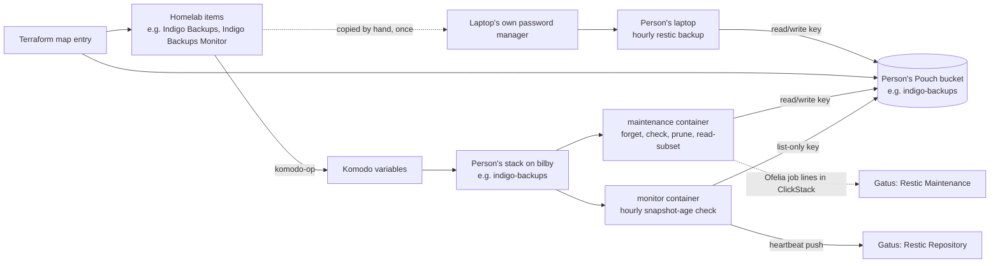
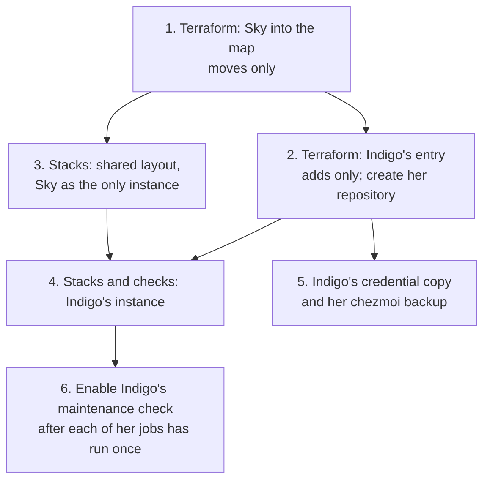

# Laptop backups for each person in the family

## Goal

Sky's and Indigo's laptops each back up hourly to their own restic repository
on Pouch, maintained and monitored from bilby. Both are entries in one
per-person mechanism: adding a person means adding one Terraform map entry,
one small stack directory and two Gatus checks. Sky's bucket, credentials,
repository and laptop configuration do not change.

This work starts once Indigo's laptop, `shadow`, is usable. Her laptop setup
does not wait for it.

## Why generalise instead of copying Sky's pieces

Every piece of the backup chain is named for Sky: the bucket and its
identities in `terraform/rustfs_pouch.tf` and `terraform/rustfs_credentials.tf`,
the `sky-backups/` maintenance stack, the monitor container and script in the
`gatus/` stack, and the two Gatus checks. Giving Indigo the same backup by
copying would duplicate all of it, and the next person would duplicate it
again.

| Cost of adding a person | Copy Sky's pieces | Generalised |
|---|---|---|
| Terraform | about 200 lines (storage, identities, items, four generated secrets) | one map entry of about 5 lines |
| Maintenance and monitor | a new stack (about 70 lines), a renamed copy of the 168-line monitor script, a new monitor service in `gatus/` | one directory: a `stack.toml` and a compose overlay of Ofelia schedules, about 35 lines |
| Gatus checks | two endpoints, about 50 lines | the same two endpoints |
| Tests | two copied test files | none; the shared scripts are already tested |

The one-time cost of generalising is 13 Terraform `moved` blocks, a move of
Sky's stack into the shared layout, and two manual Komodo actions during that
move (see [Order of work](#order-of-work-and-keeping-sky-covered)). Complexity
is deleted, not moved: the Sky-specific monitor script and stack become one
shared copy.

**Kill criterion.** If Terraform cannot express the move of Sky's resources as
moves alone (its plan shows any replacement or destruction of a Sky resource,
or an in-place change to her `Sky Backups` item), stop. Do not apply. Give
Indigo copied pieces instead and record why here.

## One name per person drives everything

Each person has a short lower-case name (`sky`, `indigo`) and a display name
(`Sky`, `Indigo`). Every per-person name below is derived from them, and Sky's
derived names are exactly her current ones. That is what lets her resources
move without being renamed, and what keeps the existing Sky plans and runbook
commands correct.

| Thing | Pattern | Sky (unchanged) | Indigo (new) |
|---|---|---|---|
| Bucket, policy and RustFS user | `<name>-backups` | `sky-backups` | `indigo-backups` |
| List-only monitor identity | `<name>-backups-monitor` | `sky-backups-monitor` | `indigo-backups-monitor` |
| Repository | `s3:https://pouch.pod.haus/<name>-backups/personal-laptop` | as now | `.../indigo-backups/personal-laptop` |
| 1Password items (Homelab) | `<Display> Backups`, `<Display> Backups Monitor` | as now | `Indigo Backups`, `Indigo Backups Monitor` |
| Komodo variables (derived by `komodo-op` from item titles) | `OP__KOMODO__<DISPLAY>_BACKUPS__*`, `..._BACKUPS_MONITOR__*` | as now | `OP__KOMODO__INDIGO_BACKUPS__*`, `OP__KOMODO__INDIGO_BACKUPS_MONITOR__*` |
| Komodo stack | `<name>-backups` | `sky-backups` | `indigo-backups` |
| Containers | `<name>-backups-maintenance`, `<name>-backups-monitor` | as now | `indigo-backups-maintenance`, `indigo-backups-monitor` |
| Ofelia jobs (the Gatus query matches these) | `<name>-backups-forget`, `-check`, `-prune`, `-read-subset`, `-monitor` | as now | `indigo-backups-*` |
| Gatus checks (group Backup) | `<Display> Restic Repository`, `<Display> Restic Maintenance` | as now | `Indigo Restic Repository`, `Indigo Restic Maintenance` |
| Gatus push key for the repository check | `backup_<name>-restic-repository` | as now | `backup_indigo-restic-repository` |

The push key is Gatus's own derivation from the group and check name, so the
check's name must follow the pattern for the monitor's push to land.

## How one person's backup fits together

The laptop never talks to bilby or Gatus. It only writes snapshots; bilby
thins, checks and prunes them; the monitor watches for new snapshots from the
storage side.

## Storage and credentials in Terraform

A local map in `terraform/rustfs_pouch.tf`, `laptop_backups`, holds one entry
per person, keyed by the short name. Each entry carries the display name, the
two service-account access-key IDs, and whether that person's generated
secrets include symbols. Every per-person resource becomes `for_each` over the
map:

- the bucket (keeping `prevent_destroy` and versioning off), its read/write
  policy, user and service account;
- the list-only monitor policy, user and service account;
- the `<Display> Backups` item (S3 keys as username and password; a Restic
  section with the repository URL, a generated restic password and the region)
  and the `<Display> Backups Monitor` item, both in Homelab;
- the four generated secrets in `terraform/rustfs_credentials.tf`.

The `sky_backups_repository` output becomes one output mapping each person to
their repository URL.

**Sky's resources move; nothing is recreated.** Thirteen `moved` blocks carry
each Sky address to its `["sky"]` instance (bucket, two policies, two users, two
service accounts, two items, four generated secrets). The bodies stay
attribute-for-attribute identical for Sky. The moved blocks can be deleted
after the apply, because this root has one state and no module callers.

**Access-key IDs stay literals in the map.** Sky's two IDs are already
committed literals and are identifiers, not secrets. Indigo's two are generated
once by hand in the 20-character upper-case letters-and-digits form RustFS
issues, and committed the same way. Rejected: generating them in Terraform as
`fenwick-dev` does, because Sky's literals would have to be imported into that
resource, and an imported random string records default generation settings
that differ from the configured ones, which forces a replacement of her key.

**Indigo's generated secrets are letters and digits only.** Komodo writes a
stack's environment file unquoted (checked in Komodo's source,
`lib/environment/src/lib.rs`), and Compose interpolates any `$` in it, so a
generated secret containing `$` would reach the container altered. Fenwick's
secrets avoid symbols for the same reason. Sky's secrets were generated with
symbols and work in practice, and changing the setting on a generated secret
or on the item's password recipe would regenerate it. So the map entry records
the setting per person: `true` for Sky, to keep her values, and `false` for
Indigo and anyone after her.

## Maintenance and monitor stacks on bilby

### Layout: the shared-service pattern, one stack per person

The repository's pattern for several instances of a service is
`<service>/compose.shared.yaml` plus a subdirectory per instance, each its own
Komodo stack that lists both files (`backup/`, `autoheal/`, `logging/`, where
the instances are hosts). Here the instances are people on the same host. The
pattern fits, and it is simpler than one stack holding a container per person,
for three reasons:

- **Sky's stack keeps its name.** The resource sync only adds; a renamed stack
  leaves the old one in Komodo with its container still running and its Ofelia
  jobs still registered, which would then clash with the new stack's identical
  job names. With one stack per person, Sky's instance is still the
  `sky-backups` stack, and only its files move.
- **Each person's secrets stay in their own stack.** One combined stack would
  carry every person's repository key and password in one environment block,
  under person-prefixed names.
- **A failed deploy affects one person.** Each stack deploys, and fails, on
  its own.

The new layout, replacing `sky-backups/` and the backup-monitor pieces of
`gatus/`:

| Path | Job | Origin |
|---|---|---|
| `laptop-backups/compose.shared.yaml` | Defines two services, `maintenance` (the idle `restic/restic` container that Ofelia execs into) and `monitor` (the snapshot-age checker), with every per-person value taken from the stack environment: container names, restic hostname, bucket, Gatus push key. Lists `../maintenance` as extra content so a script change recreates every person's maintenance container. | Generalised from `sky-backups/compose.yaml` and the monitor service in `gatus/compose.yaml` |
| `laptop-backups/maintenance/maintain.sh` | Forget, check, prune and read-subset, unchanged in behaviour. | Moved from `sky-backups/scripts/`, Sky wording removed |
| `laptop-backups/monitor/` | The monitor image and its script, reading bucket, prefix, maximum age and Gatus push key from the environment instead of hard-coding Sky's. | Moved from `gatus/Dockerfile.monitor` and `gatus/scripts/check-sky-backups.sh` |
| `laptop-backups/<name>/stack.toml` | Stack `<name>-backups` on bilby: run directory, the two compose files, `run_build = true` for the monitor image, and the environment, which maps the person's Komodo variables to generic names (`RESTIC_REPOSITORY`, `MONITOR_ACCESS_KEY` and so on) plus `PERSON=<name>`. | Sky's from `sky-backups/stack.toml` and two lines of `gatus/stack.toml`; Indigo's new |
| `laptop-backups/<name>/compose.yaml` | Only the person's Ofelia labels on the two services: job names and schedules. | Sky's labels moved verbatim; Indigo's new |

The Ofelia labels are the one part that cannot be shared: their keys contain
the job name, and Compose substitutes variables into values, not keys.
Indigo's maintenance jobs run 30 minutes after Sky's, so the two repositories'
checks and data reads never load Pouch at the same time. Her laptop is almost
always off at that hour, as Sky's is.

The pipeline rules apply unchanged: every service carries the content-hash
label and the monitor carries its build-hash argument with the matching
Dockerfile lines (`tools/lint-stack-content-hash.py` checks both); every
environment key is referenced in a compose file (`tools/lint-stack-env.py`
reads both files of a multi-file stack); no stack sets `deploy = true`; every
bind path starts at `${PODHAUS_REPO}`.

### The monitor moves next to the maintenance container

Today the monitor is a service in the `gatus` stack with Sky's list-only
credential in Gatus's environment. Moving it into each person's stack puts
everything about one person's backups in one directory. Gatus's stack keeps
only the two checks. The monitor keeps its separate list-only identity, so the
monitor still cannot read or delete a backup object. This is a decision for
Nathan (see [Decisions](#decisions-for-nathan)): the watering monitor is a
precedent for monitors living in the `gatus` stack.

## Gatus checks

Each person has the two existing checks, as separate endpoints so the status
page shows each person red or green and the alert names them:

- **`<Display> Restic Repository`**: a push endpoint with a two-hour heartbeat
  window, fed by that person's monitor. Sky's is unchanged.
- **`<Display> Restic Maintenance`**: the ClickHouse query over Ofelia's
  `Job stop` lines, matching that person's job names. Indigo's is a copy of
  Sky's with the names changed. Sky's is unchanged, because her job names are
  unchanged.

A new person's maintenance check would be red for up to a month, because it
needs a successful monthly prune and data read and those jobs have not had
their first run. Indigo's maintenance check therefore lands disabled, and is
enabled once Ofelia has logged a successful run of each of her four jobs. The
repository check is enabled from the start, since the repository's creation
starts its 14-day grace window.

A mismatch between a person's stack and their checks fails visibly in both
directions. A monitor whose check is missing gets an error from Gatus when it
pushes, and the job fails. A check whose monitor is missing goes stale after
two hours and alerts.

## Getting Indigo's credentials onto her laptop

The `Indigo Backups` item must be in Homelab, because `komodo-op` reads only
Homelab and bilby's maintenance container needs the same key and restic
password. Indigo's laptop reads its credentials through her own 1Password
account when chezmoi applies. Her chezmoi source already installs the
1Password app and command-line tool. So the item must also exist in a vault she
can see.

What was checked:

- Indigo is an active member of the same 1Password account as Nathan.
- The Homelab and Dev vaults are shared with Nathan alone.
- Terraform runs under the operator machine's `dev` service account, and each
  machine has its own. `op-vault mint` proves read and write access to exactly
  Homelab and Dev before it stores a token, and on this machine the token sees
  only those two vaults. Terraform cannot write anywhere Indigo can read.
- 1Password's documentation states that a service account's vault access
  "can't be changed later". Reaching a new vault means minting a new service
  account on every operator machine.

The two ways to place the item are a decision for Nathan (see
[Decisions](#decisions-for-nathan)). Either way, the vault is a dedicated one
shared between Nathan and Indigo alone, never the family's default shared
vault, which every family member sees. The recommendation is a one-time copy
made in the 1Password app ("copy to vault"), which carries every field and
section. That matches how Sky's laptop is fed today: its Bitwarden item is a
hand copy of `Sky Backups`.

## What Indigo's laptop needs from this work

Her chezmoi source mirrors Sky's backup setup, reading 1Password instead of
Bitwarden. This work gives it:

| Item | Value |
|---|---|
| Endpoint | `https://pouch.pod.haus` |
| Repository | `s3:https://pouch.pod.haus/indigo-backups/personal-laptop`, already created by this work; the laptop never runs `restic init` |
| Region | `us-east-1` |
| Credential item | `Indigo Backups`, in the vault Nathan shares with her |
| S3 access key ID | the item's `username` field |
| S3 secret access key | the item's `password` field |
| Restic password | field `RESTIC_PASSWORD` in the item's `Restic` section (the same section also holds `RESTIC_REPOSITORY` and `AWS_DEFAULT_REGION`) |
| Her key's reach | read, write and delete objects, list and locate, on `indigo-backups` only |

Her chezmoi source reads these through 1Password references of the form
`op://<vault>/Indigo Backups/password` and
`op://<vault>/Indigo Backups/Restic/RESTIC_PASSWORD`, so the 1Password app
must be signed in and its command-line integration enabled when chezmoi
applies.

The client contract is Sky's: snapshots tagged `personal-laptop`, restic host
`<hostname>-<first eight characters of /etc/machine-id>` (so `shadow-…`), a
15-minute lock wait, no `--skip-if-unchanged` (it suppresses the snapshot the
monitor looks for), and no forget, prune or check timers on the laptop.

## Order of work and keeping Sky covered

Sky's laptop writes straight to Pouch, so her backups continue whatever
happens on bilby. Cover here means her monitor and maintenance. Each step
below keeps them running, or leaves a gap shorter than the window its Gatus
check allows.

| Step | Change | Sky's cover during it | Verified by |
|---|---|---|---|
| 1. Sky into the Terraform map | Map with Sky's entry only; `for_each` resources; 13 `moved` blocks; output reshaped. | Nothing changes. | `terraform plan` lists 13 moves and "0 to add, 0 to change, 0 to destroy", with only the output differing. After the apply a second plan reports no changes, and Komodo's `OP__KOMODO__SKY_BACKUPS__*` variables are not updated (`komodo-op` logs only changes). |
| 2. Indigo's Terraform entry | Add her entry with new access-key IDs and letters-and-digits secrets. Apply. Then create her repository once from an operator machine, with the `Indigo Backups` values supplied by `op run` to a throwaway `restic/restic` container. | Untouched. | The plan adds 13 resources and changes nothing of Sky's. Within a minute Komodo has the `OP__KOMODO__INDIGO_BACKUPS__*` and `..._MONITOR__*` variables. `restic cat config` succeeds against her repository. Creating it here, before her stack exists, means her monitor's first run sees a repository in its grace window, not a missing one. Do this when her laptop can start backing up within 14 days, or her repository check goes red. |
| 3. Shared layout, Sky only | Add `laptop-backups/` with Sky's instance; delete `sky-backups/`, the monitor service, its script and Dockerfile, and Sky's two monitor variables from `gatus/`; rename and adapt the two test files. Docs updated in the same commit. | Sky's maintenance service is renamed (`sky-backups-maintenance` becomes `maintenance`, keeping its container name), and her monitor moves from the `gatus` project to `sky-backups`. Komodo deploys with `compose up -d` and never removes orphaned containers (checked in Komodo's source), so either move would collide on a container name, or leave a stray container still registering the same Ofelia job. So, immediately before the push and away from 03:00–05:00 and the :15 monitor run, destroy the `sky-backups` stack and only the `sky-backups-monitor` service of the `gatus` stack from Komodo. The push redeploys both in minutes: maintenance runs only overnight, and the repository check allows two hours. | `tools/check` passes before the push. After it: `docker ps` on bilby shows `sky-backups-maintenance` and `sky-backups-monitor` in the `sky-backups` project and nothing of that name in `gatus`. `docker logs ofelia` registers each Sky job once. `docker exec sky-backups-maintenance /scripts/maintain.sh check` succeeds, a manual monitor run pushes success, and `Backup / Sky Restic Repository` is green. `Backup / Sky Restic Maintenance` stays green through the next nightly forget. Then remove the orphaned old cache volume. |
| 4. Indigo's instance | Add `laptop-backups/indigo/` and her two Gatus checks, the maintenance check disabled. | Untouched; only Gatus restarts. | The push's final deploy stage creates `indigo-backups` as a new stack. `docker logs ofelia` registers her jobs. Her monitor reports "first-backup grace window" and `Backup / Indigo Restic Repository` is green. A manual `maintain.sh check` in her container succeeds. |
| 5. Her laptop | Copy the item to her vault; her chezmoi source gains the backup timer and templates (in her repository). | Untouched. | A manual run of her backup service succeeds, a snapshot from host `shadow-…` appears in `restic snapshots` from `indigo-backups-maintenance`, and her monitor reports a fresh committed snapshot. |
| 6. Her maintenance check | Enable `Indigo Restic Maintenance` once Ofelia has logged a successful forget, check, prune and read-subset for her. | Untouched. | The check is green on its first evaluation. |

Steps 1 and 3 are independent and can land in either order. Step 4 needs
both: its stack uses step 3's shared files and step 2's variables.

**Rolling back step 3** has the same container-name collision in reverse:
destroy the `sky-backups` stack, revert the commit, and push. The gatus stack
then recreates its monitor service.

## Verification

### Tests, written red first

| Property | Test | Why it fails first |
|---|---|---|
| A person's monitor reports to that person's Gatus check and lists that person's repository | The ported monitor test (`tools/tests/test_laptop_backups_monitor.py`, from `test_sky_backups_monitor.py`) runs the script with Indigo-style settings and asserts the push goes to the given key and the listing targets the given bucket and prefix. | The current script hard-codes Sky's push key and its own alias name. |
| Monitor states (fresh, grace window, stale, missing, query and parse failures never reporting success) | The existing monitor cases, ported to the generic setting names. | Pass on port; they guard the refactor. |
| Maintenance behaviour (prune forgets first, retention per host, monthly read rotation, unknown operation touches nothing) | The existing maintenance cases, ported (`tools/tests/test_laptop_backups_maintenance.py`) to the moved script path. | Pass on port; nothing in them is person-specific. |
| Stack wiring | `tools/lint-stack-env.py` and `tools/lint-stack-content-hash.py` over both person stacks, run by `tools/check`. | Already enforced; they catch a missing label, build argument or environment reference. |

No test checks that the Terraform map, stack directories and Gatus checks list
the same people. The live failure modes above already make a mismatch loud,
and such a test would only restate configuration.

### Infrastructure and live checks

The Terraform plan figures and the live checks for each step are in the table
above. A baseline `terraform plan` (run without taking the state lock) on
2026-11-12 reported no changes. So any difference step 1's plan shows comes
from this work, including the already-applied, uncommitted Indigo group change
in `terraform/pocket_id.tf`.

## Docs that change

`docs/` describes the result in the same commit as each step:

| Page | Change |
|---|---|
| `docs/runbooks/pouch-rustfs.md` | Becomes the per-person runbook: the naming table, the people currently served, the credential handoff (Homelab item, plus the copy each laptop reads), the maintenance table per person, the monitor in each stack, and an "Adding a person" checklist (map entry, stack directory, two checks, create the repository, copy the item). |
| `docs/backup-and-recovery.html` | "Sky backups on Pouch" becomes family laptop backups, one repository per person. |
| `docs/monitoring.html` | The storage-driven backup check describes per-person monitors in each person's stack, with Indigo's checks. |
| `docs/scheduling.html` | Monitor jobs run from `<name>-backups-monitor` in the person's stack; Indigo's rows added. |
| `docs/secrets.html` | Item table lists both people's `Backups` and `Backups Monitor` items, and notes that each laptop reads a copy outside Homelab. |
| `docs/storage.html` | Pouch holds one restic bucket per person. |
| `docs/terraform.html` | The Pouch section describes the `laptop_backups` map instead of Sky's resources. |
| `docs/architecture.html` | The Pouch mention names per-person backup buckets. |

`docs/plans/quokka-loan.md` and `docs/plans/sky-framework-return.md` name
Sky's containers, jobs and item. They stay correct because those names do not
change.

## Decisions for Nathan

| Decision | Options and trade-off | Recommendation |
|---|---|---|
| How Indigo's credential reaches a vault she can see | **Copy by hand once** into a vault shared only with her. Cost: a second copy that a key rotation must refresh by hand. A stale copy fails loudly: her backup service fails, and her repository check goes red within 14 days. **Terraform writes a second item** into that vault. No drift, but every operator machine must mint a new `dev` service account (vault access cannot be extended) and `op-vault mint`'s required vaults change in chezmoi. Until each machine is re-minted, Terraform fails on it, breaking the run-from-any-machine rule. Every machine's token also gains write access to a vault Indigo uses. | Copy by hand. Keys are not rotated routinely, and Sky's laptop already works this way. Revisit if a third laptop joins or rotation becomes routine. Nathan names or creates the vault. |
| Where the monitors live | **In each person's stack.** One directory per person; Gatus loses person-specific services and credentials; costs one manual destroy of Gatus's monitor service during step 3. **In the `gatus` stack**, as the watering monitor is. No cutover action for the monitor, but each person adds a monitor service and two credential lines to Gatus. | In each person's stack. |
| Keep a separate list-only monitor identity per person | **Keep it.** Sky's moves untouched, and the monitor still cannot read or delete backups. **Drop it** and let the monitor use the person's read/write key, which now sits in the same stack. Saves three RustFS resources, an item and two secrets per person, but destroys Sky's monitor identity and removes a deliberate privilege split. | Keep it. |
| Indigo's retention and schedule | **Same retention as Sky** (hourly for 2 days, then 7 daily, 5 weekly, 12 monthly, 3 yearly), jobs 30 minutes after Sky's. **Different retention per person** needs a per-person setting in the maintenance script. | Same retention, staggered schedule. |
| Names | `laptop-backups/` for the directory and `laptop_backups` for the Terraform map. "family-backups" also reads well, but it suggests the household's other backups, which live in `backup/`. | `laptop-backups`. |

## Open questions and things not verified

- **Whether Sky's secrets contain `$`** was not checked, because that means
  reading the secrets. Her maintenance and monitor working today shows her
  values survive the unquoted environment file. Nothing in this plan changes
  them.
- **Komodo behaviour was read from Komodo's current main branch** (deploy runs
  `compose up -d` with no orphan removal; a service-filtered destroy exists).
  The deployed version was not compared. If it differs, step 3's two destroys
  are still sufficient.
- **The plan has not been through `terraform plan`.** Only the no-change
  baseline was run. Step 1's plan is the gate, under the kill criterion above.
- **Which vault Indigo can see** is for Nathan to name. The service account can
  list only Homelab and Dev, and those are shared with Nathan alone.
