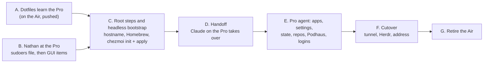

# MacBook Pro migration

## Goal

`nb-macbook-pro` does everything `nb-macbook-air` does today, under its own
name, with the Air kept fully working until the Pro is proven, and the
migration itself driven by an agent on the Pro from the earliest point that
is possible.

## Decisions

Settled with Nathan on 2026-11-09. The three ASK rows at the end of the
repositories table are the only open items.

| # | Decision | Outcome |
|---|---|---|
| D1 | Private Wi-Fi Address on the Pro for the home network | Off. Done in the GUI at the Pro, not over SSH, because the Pro is reached over that Wi-Fi link |
| D2 | The two Macs accept each other's machine key | Yes: the Air's fleet entry gains the shared key and the authorized-keys template grants every fleet host's key except the host's own |
| D3 | Temporary passwordless sudo for `nathan` on the Pro | Authorised. Nathan creates `/etc/sudoers.d/zz-bootstrap`; the agent removes it at the end of stage E |
| D4 | Fix the dotfiles scripts that abort a fresh apply | Yes: skip parked hosts in the clipboard-tunnel script; skip the Herdr link script when `hc` is absent; correct the setup guide's order |
| D5 | Docs tunnel identity at cutover | Rename the tunnel client to `nb-macbook-pro` in Podhaus; derive the 1Password field label from `uname -n` in the dotfiles |
| D6 | 32 uncommitted Herdr config files | Commit and push from the Air as WIP, two commits by feature. What runs on the Air is what the Pro gets |
| D7 | Branches with commits on no remote | Keep only meaningful content; see the repositories table for the per-branch verdicts |
| D8 | Large folders | `Documents`, `Desktop`, `Pictures` move. `Downloads` (42 GB) and `Rescue` (105 GB, a finished data-recovery job: the FROST recovery report, the recovered `ecroeser` home folder and repaired media) do not move |
| D9 | Syncthing | Fresh device identity on the Pro, re-pair |
| D10 | Apps no longer wanted | Drop iTerm, Visual Studio Code, Bartender, ChatGPT Classic (keep the cask ChatGPT), Goose desktop, ngrok. Keep StreamFab |
| D11 | What chezmoi starts managing | Approved: see "Chezmoi additions" in stage E |
| | `veil-voice` | Commit the three plan files and push the `voice` branch |
| | `cluster_to_23snaps` | Create `LogicWolfe/cluster_to_23snaps` on git.pod.haus and push |

## Stages, by dependency



Status markers: ✅ done, 🔄 in progress, ⏳ not started.

### A. Dotfiles learn the Pro (on the Air) ✅ commit `b76b982`

Committed and pushed to `git.pod.haus:LogicWolfe/dotfiles` before the Pro's
first apply. Every Air entry stays: removing one would abort the Air's own
next apply, because the pi MCP file renders through the secret runner, which
refuses an unknown host.

| File | Change | Why |
|---|---|---|
| `.chezmoidata/fleet.toml` | `[fleet.nb-macbook-pro]`: `user = "nathan"`, `lan = false`, `mdns_host = "nb-macbook-pro.local"`, host key `ssh-ed25519 AAAAC3NzaC1lZDI1NTE5AAAAIO9kCdfWWKkCjHGss6J40w5VOUZuEHX/hYswV/64tLxA`, `devbox = false`, `development = true`, `switch_development = true`, `podhaus_operator = false`, `oom_order = false`, `parked = false`; `machine_key` (the shared key) on both Mac entries | `development` turns on Lumen, the docs server, Forgejo login and the Herdr checkout; `podhaus_operator = false` keeps the docs tunnel off until stage F; `mdns_host` gives every host a direct LAN route without waiting for the Podhaus DNS record |
| `.chezmoitemplates/lumen-enabled`, `.chezmoitemplates/switch-vault-enabled` | Read the fleet entry's `development` and `switch_development` flags instead of hard-coded hostnames | A rename becomes one fleet entry |
| `dot_local/bin/executable_op-vault` | Accept `nb-macbook-pro` for the `dev` and `switch` identities, file backend | Required; every apply aborts without it |
| `private_dot_ssh/private_authorized_keys.tmpl`, `tests/test_macbook_access.py` | Grant every fleet host's `machine_key` except the host's own (D2) | Keeps Air to Pro and Pro to Air SSH working through the bootstrap |
| `run_onchange_after_11-cc-clip-devboxes.sh.tmpl` | Skip `parked` hosts (D4) | An unreachable quokka aborted every apply and everything after it |
| `run_after_16-herdr-machines-macos.sh.tmpl` | Report and exit 0 when `hc` is absent (D4) | Herdr.app is installed by hand at stage F |
| `dot_claude/commands/ssh.md`, `README.md`, `tests/op-vault.sh` | Wording, the Claude Code install note (macOS is by hand), a test for the Pro's backend | Truthfulness |

✅ Verified: every check in the repo's CI ran locally (19 groups, 129 Python
tests), `tests/op-vault.sh` passed, all 106 templates rendered as the Pro, and
`chezmoi diff` on the Air shows only the expected additions (shared key in
`authorized_keys`, Pro routes in the SSH config, a `known_hosts.podhaus` line,
the op-vault case). The Air's next apply reruns the cc-clip devbox setup once.

### B. Nathan at the Pro (two short sittings) ✅ both sittings done, Codex skipped for now

**Sitting 1, before stage C.** One command, from the Air (plain `ssh`
prompts for the Pro's password, which sshd still accepts) or at the Pro:

```sh
ssh -t nathan@nb-macbook-pro.local "echo 'nathan ALL=(ALL) NOPASSWD: ALL' | sudo tee /etc/sudoers.d/zz-bootstrap >/dev/null && sudo chmod 440 /etc/sudoers.d/zz-bootstrap && sudo visudo -c"
```

And two GUI toggles: on the Pro, D1 (System Settings, Wi-Fi, the home
network's details, Private Wi-Fi Address off); on the Air, System Settings,
General, Sharing, Remote Login, "Allow full disk access for remote users" on,
so the Pro agent can pull privacy-protected folders such as Firefox's over
SSH (the Air's 1Password agent was locked when this was tested, so the
current state is unknown). Everything root-level after that is the agent's.

**Sitting 2, after stage C's apply.** GUI only:

| Item | What Nathan does |
|---|---|
| 1Password | Open the app (installed by the agent), sign in, enable Settings, Developer, SSH agent and CLI integration |
| Claude Code | `claude` then `/login`; `claude-switch` then `/login` for the Switch account. Stage D needs the first one |
| Codex | `codex login --device-auth`; start `codex` once and choose "Trust all and continue" |
| GitHub CLI | `gh auth login --web` |
| OrbStack, Adrafinil | Open each once and approve its helper |
| Notion MCP | `/mcp` in each Claude account, `codex mcp login notion`, `pi mcp login notion` |
| App Store | Sign in, so stage E can run `mas install` |
| Later, as apps start | Accessibility, Screen Recording, Full Disk Access and Input Monitoring grants; Safari extension toggles; Signal and WhatsApp device links; Microsoft 365, Slack, Plex, Steam, NordVPN, Tailscale logins; iStat Menus, Lunar, StreamFab licence entry |

### C. Root steps and headless bootstrap (from the Air) ✅

✅ Done 2026-11-09: hostname set, Homebrew, Touch ID sudo, key-only sshd,
both tokens, cc-clip, `chezmoi init` with seeded prompt answers, `chezmoi
apply --force` to exit 0 after seven attempts (each failure is in the log and
fixed in the dotfiles), fish as the login shell, Claude Code 2.1.319, GitHub
CLI signed in by piping the Air's token, Ghostty and Fastmail installed.
What the attempts taught is in the migration log; the scripts that worked
are `stage-c-root.sh` and `stage-c-bootstrap.sh`, kept under `~/bootstrap` on
the Pro and worth folding into Podhaus.

With the sudoers file in place, the agent runs on the Pro over SSH, in this
order:

| Step | Command or action | Why here |
|---|---|---|
| Hostname | `scutil --set HostName/LocalHostName/ComputerName nb-macbook-pro` | Everything reads `uname -n`; an apply as `Mac` aborts in the secret runner |
| Homebrew | `NONINTERACTIVE=1` Homebrew installer, which also installs the Xcode Command Line Tools | Before any template renders |
| Touch ID for sudo | `/etc/pam.d/sudo_local` with `auth sufficient pam_tid.so`, root:wheel 444 | An always-run script aborts the apply without it |
| Key-only sshd | `/etc/ssh/sshd_config.d/000-key-only.conf` (no password, no keyboard-interactive, no root, `AllowUsers nathan`), `sshd -t` | After stage A is pushed, so the shared key stays granted |
| Temporary tools | `brew install chezmoi node`, `brew install --cask 1password-cli 1password` | Three JSON templates `exec node` at render time; mise removes Homebrew's node later |
| Bootstrap identity | `~/.ssh/config.d/90-bootstrap.conf`: `Host *` / `IdentityFile ~/.ssh/id_nb-macbook-pro`. Never a `~/.ssh/config` | Lets the clipboard script reach the devboxes with no 1Password agent |
| `chezmoi init` | `GIT_SSH_COMMAND` pinned to the machine key, `--promptBool headless=false --promptString podhausLan=auto`, the Forgejo URL | Clone with the already-registered key |
| `chezmoi apply` | Homebrew, `~/.local/bin`, mise shims, cargo on `PATH`; rerun once if a script was fixed in between | The package script does not set `PATH` |
| fish | `/opt/homebrew/bin/fish` into `/etc/shells`, `chsh` | The apply only prints these |
| Claude Code | `curl -fsSL https://claude.ai/install.sh \| bash` | Chezmoi installs it on Linux only |
| After sitting 2 | `chezmoi init` (no URL) then `chezmoi apply`; delete `90-bootstrap.conf` | Flips the 1Password flag computed at init |

Verification: `chezmoi status` lists only always-run scripts;
`ssh-machine -T git@git.pod.haus` authenticates as LogicWolfe;
`op-vault dev -- op vault list` lists Dev; `docs-url` prints a working
localhost link; from the Air, `ssh-machine nathan@nb-macbook-pro.local true`
still works; `sudo sshd -T` shows `passwordauthentication no`.

### D. Handoff to an agent on the Pro ✅ 2026-11-09

Moves to the same paths on the Pro: this plan, its appendices and the
[migration log](macbook-pro-migration-log.md) through a clone of `podhaus`;
this session's working notes `~/.claude/notes/94c571e6-4cda-4128-96dd-f1f08d02008f-main.md`.
Pro to Air SSH is `ssh-machine nathan@nb-macbook-air.pod.haus` (D2; the Air's
Bonjour name is `nathans-macbook-air.local`, not its hostname).

Started as a Herdr space on the Pro (terminal `migration`, in
`~/repos/podhaus`) rather than tmux, at Nathan's request: Herdr.app 0.1.14
was copied from the Air and launched, which installed herdr-core 0.1.19, the
latest release of generation 1; the next apply linked voltaire, bandicoot,
bilby and fractal, and `hc machine update` brought each devbox's core to
0.1.19. The brief is `~/bootstrap/stage-d-brief.md` on the Pro. The agent runs
stage E unattended and stops before stage F.

### E. Pro agent: applications, settings, state, repositories, Podhaus ✅ 2026-11-09

**Where it stands.** Every sub-stage is done, the Firefox profiles are in
place, the 1Password agent is wired in and the bootstrap identity file is
gone. An evening audit of both machines (apps, settings, home state,
repositories and agents) found no gap the agent could close that it did not
close. What remains is one sitting at the keyboard and a short list of
decisions, broken down in [what is left](macbook-pro-migration/remaining.md).
Stage F waits for Nathan to confirm the Pro is good for daily work.


#### E1. Applications to install ✅ installed; sign-ins pending

Beyond what the first apply already installs (Homebrew; fish, git-delta,
starship, git-lfs, cloudflared, gh, awscli, micro, tmux, zellij, mise,
uutils, fortune, jq, direnv, azure-cli, wstunnel, caddy; the casks
1password-cli, codex, zed, orbstack, adrafinil; Ollama and Lumen; the mise
tool set).

| App | Install | Sign-in or licence | Carried from the Air | Nathan needed |
|---|---|---|---|---|
| 1Password | cask `1password` | Account and Secret Key | Nothing (vault syncs) | Sign in, enable SSH agent |
| iStat Menus 7 | cask `istat-menus` | Licence key is inside the copied plist; re-enter from the Bjango account if it does not take | Copy the four `~/Library/Preferences/com.bjango.istatmenus*.plist` files before the first launch on the Pro (Nathan: migrate the config); its Application Support folder is 257 MB of app copies and history, not settings, so it stays. Fallback: Export Settings on the Air, Import on the Pro | Helper approval, licence check |
| Lunar | cask `lunar` | Paddle licence re-activated | Paddle files `650170.padl`/`.spadl`; display settings for the external monitors | Re-activate, Screen Recording and Accessibility grants, login item |
| Magnet | App Store | Apple ID purchase | `com.crowdcafe.windowmagnet` plist | Accessibility grant, login item |
| Stay | cask `stay` (the Air has the App Store build) | Its own licence or App Store | `Stay.sqlite` layouts, partly display-specific | Accessibility and Screen Recording, login item |
| DaisyDisk | cask `daisydisk` | Licence file copies | `License.DaisyDisk` | Full Disk Access |
| Hush | App Store or cask `hush` | Free | Nothing | Safari extension toggle |
| Transmission | cask `transmission` | Free | Plist and torrent list | None |
| Moonlight | cask `moonlight` | Free | Plist with paired hosts | None |
| NordVPN | cask `nordvpn` | Account | Nothing | Network extension approval |
| Google Chrome | cask `google-chrome` | None: a dev test browser, never signed in | Nothing | None |
| Brave Browser | cask `brave-browser` | Sync chain | Nothing | Sync |
| Firefox | cask `firefox` | Firefox Account | Both profiles: the whole `~/Library/Application Support/Firefox` folder (`profiles.ini`, `installs.ini`, `Profiles/`), copied with Firefox quit on the Air; becomes default browser | Quit Firefox for the copy, confirm default |
| Orion | cask `orion` | Kagi account | Nothing | Sign in |
| 1Password for Safari, Kagi for Safari, Consent-O-Matic | App Store | Apple ID | Nothing | Safari toggles |
| Ghostty | cask `ghostty` | Free | Config is chezmoi's | None |
| Claude (desktop) | cask `claude` | Anthropic account | `claude_desktop_config.json` (both profiles) | Sign in, grants |
| ChatGPT | cask `chatgpt` | OpenAI account | Nothing | Sign in, grants |
| Slack | cask `slack` | Workspaces | Nothing | Sign in |
| Signal | cask `signal` | Phone link | Nothing (new device link) | Link |
| WhatsApp | cask `whatsapp` | Phone link | Nothing | Link |
| Fastmail | cask `fastmail` | Account | Plist | Sign in |
| Plex | cask `plex` | Account | Nothing | Sign in |
| Steam | cask `steam` | Account | Nothing (games redownload) | Sign in |
| StreamFab | Direct download (streamfab.com) | Licence re-activated | Nothing found on disk | Licence |
| Publii | cask `publii` | Free | `~/Library/Application Support/Publii` sites | None |
| Pixelmator Pro, Ulysses, Kindle, Parcel, Speedtest | App Store | Apple ID (Ulysses, Parcel subscriptions) | Pixelmator presets from its container; Ulysses via iCloud | App Store sign-in |
| Microsoft Word, Excel, PowerPoint, Outlook, OneDrive, To Do | App Store (`mas install`), as on the Air | Microsoft 365 account | Nothing | App Store sign-in, then Microsoft sign-in; OneDrive approval |
| Microsoft Teams | cask `microsoft-teams` (not on the App Store) | Work account | Nothing | Sign in; Screen Recording, microphone, camera |
| Audible, Big Ass Fans, Sensibo, MacroFactor (shows as "Runner") | App Store, iPhone apps (GUI only) | Accounts | Nothing | Install from the App Store app |
| Herdr | Direct download (releases.herdr.dev), at stage F | None | `shared.json` from the Air for layout and colours | Launch once |

Dropped per D10: iTerm, Visual Studio Code, Bartender, ChatGPT Classic,
Goose desktop and `block-goose-cli`, ngrok, Mouser (not running, not a login
item, config untouched since May), Conductor, CrossOver, balenaEtcher, MailMate, Spriggy, IINA, Mist, Alfred
(for now: Spotlight, kept minimal, takes its place), and the local `Brave.app`
AppleScript launcher.

**Homebrew formulae.** Each one on the Air, with what it is, how often its
command appears in the fish history (agents' shells do not write there, so a
zero is weak evidence) and a recommendation. "Chezmoi" rows are installed by
the package script on every Mac; culling one of those is a dotfiles edit.

| Formula | What it is | Evidence | Recommendation |
|---|---|---|---|
| mas | App Store installer from the command line | New need (E1 App Store installs) | Install |
| rsync | Current rsync (macOS ships an old one) | 1 use; the migration copies use it | Keep |
| rclone | Cloud storage sync, remotes configured in `~/.config/rclone` | 3 uses | Keep |
| sapling | Meta's `sl` source control client | 11 uses | Drop (Nathan) |
| sentry-cli | Sentry releases and source maps | 5 uses | Keep |
| tailscale | Tailscale CLI and daemon | 5 uses | Keep |
| syncthing | File sync service, running on the Air | Service started | Keep, fresh identity (D9) |
| git-machete | Branch-stack management | 2 uses; Graphite is also installed for stacks | Drop (Nathan) |
| mist-cli | Downloads macOS installers (pairs with the Mist app) | 4 uses | Drop, with the Mist app (Nathan) |
| poppler | `pdftotext`, `pdfinfo`; the pdf skill uses them | 0 direct uses, used by agents | Keep |
| tesseract | OCR; the pdf skill uses it for scanned PDFs | 0 direct uses | Keep (Nathan) |
| pandoc | Document format conversion | 0 uses | Keep (Nathan) |
| ffmpeg | Media transcoding | 0 direct uses; chezmoi installs it through mise (commit `60c606a`) | Drop the Homebrew copy (Nathan) |
| libpq | `psql` client | 0 uses; mise already installs PostgreSQL binaries | Drop (Nathan) |
| pngpaste | Clipboard image to file; the managed fish cc-clip helper calls it | Already installed by chezmoi's package script | Chezmoi, keep (worked out: it is managed and used) |
| cloc | Count lines of code | 0 uses | Drop (Nathan) |
| ddrescue | Failing-disk recovery | 0 uses; from the Rescue job | Drop (Nathan) |
| e2fsprogs | ext4 filesystem tools | 0 uses; from the Rescue job | Drop (Nathan) |
| smartmontools | Disk health (`smartctl`) | 0 uses; from the Rescue job | Drop (Nathan) |
| mkvtoolnix | MKV muxing (`mkvmerge`) | 0 uses; no skill references it | Drop (Nathan) |
| git-filter-repo | Rewrite git history | 0 uses | Drop (Nathan) |
| pigz | Parallel gzip | 0 uses | Drop (Nathan) |
| typst | Typesetting system | 0 uses | Drop (Nathan) |
| signal-cli | Signal from the command line (its device link does not move) | 0 uses | Drop (Nathan) |
| block-goose-cli | Goose CLI | Dropped with Goose (D10) | Drop (Nathan) |
| fish, starship, git-delta, direnv, jq, mise, tmux, gh | Shell, prompt, diff pager, env loader, JSON, tool manager, multiplexer, GitHub CLI | Daily | Chezmoi, keep |
| git-lfs | Large file storage for git | Repos use it | Chezmoi, keep |
| awscli | AWS CLI | 14 uses | Chezmoi, keep |
| caddy, wstunnel | The docs tunnel's origin server and relay client | Required by the tunnel | Chezmoi, keep |
| fortune | Quote for the fish greeting | Greeting uses it | Chezmoi, keep |
| micro | Terminal editor | 4 uses | Chezmoi, keep |
| azure-cli | Azure CLI | 0 uses | Chezmoi, keep (Nathan) |
| zellij | Terminal multiplexer, alongside tmux | 3 uses; tmux sessions are the managed pattern | Drop from chezmoi on every host (Nathan) |
| cloudflared | Cloudflare tunnel client | 0 uses, service not running | Drop from chezmoi on every host (Nathan) |
| uutils-coreutils, uutils-findutils | Rust rewrites of coreutils and findutils | 0 direct uses | Chezmoi, keep (Nathan) |

Ollama is installed by chezmoi's Lumen step. The service starts: `brew
services start syncthing` with a fresh identity (D9); `sudo brew services
start tailscale` and a browser login.

#### E2. macOS settings to apply ✅ headless rows written; GUI rows on Nathan's list

Headless with `defaults write` unless the last column says otherwise; the
exact commands are in the [settings appendix](macbook-pro-migration/settings.md).

| Area | Setting | Air value | Takes effect |
|---|---|---|---|
| Keyboard | Key repeat rate | 2 (fastest) | Logout |
| Keyboard | Delay until repeat | 15 (shortest) | Logout |
| Keyboard | Caps Lock acts as Right Control on the built-in keyboard | Remapped | Logout |
| Keyboard | Spotlight shortcut Cmd+Space | Off on the Air for Alfred; **stays on** on the Pro, Alfred is dropped | Not applied |
| Spotlight | Search results limited to Applications, Folders and System Settings; Siri Suggestions and Websites off; "Help Apple Improve Search" off | New for the Pro. macOS 27 lists the categories turned **off** as `System.<name>` ids in `com.apple.Spotlight` `EnabledPreferenceRules` (confirmed: `System.iphoneApps`, `System.documents`; inferred from the Spotlight framework's enum: images, movies, music, presentations, spreadsheets, developer, calculator, contacts, dictionary, safari, tips, pdf; unknown: Mail and Messages, Events, Fonts, Bookmarks, Siri Suggestions, Conversion). The fourteen known ids are written; `Search Queries Data Sharing Status` already reads 2. The [Spotlight note](macbook-pro-migration/spotlight.md)'s `orderedItems` route is obsolete | Nathan finishes the six unknown rows in the GUI and reads the array back for MacBook setup |
| Keyboard | Symbolic hotkey 176, believed to be dictation | Off | Logout |
| Keyboard | Text replacements (18), smart quotes, spelling language | Already identical on the Pro via iCloud | Nothing to do |
| Trackpad | Tracking speed | 2 | Logout |
| Trackpad | Tap to click | On | Logout |
| Trackpad | Three-finger horizontal swipe | 1 (meaning not verified; the Pro default is 2) | Logout |
| Mouse | Tracking speed | 2 | Logout |
| Dock | Auto-hide | On | `killall Dock` |
| Dock | Icon size | 44 | `killall Dock` |
| Dock | Magnification, up to | On, 128 | `killall Dock` |
| Dock | App order | Air order, which adds Firefox after Safari | `killall Dock` |
| Windows | Tile windows by dragging to a side edge | Off on the Air; **stays on** on the Pro (Nathan) | Not applied |
| Windows | Tile by dragging to the top edge | Off | Logout |
| Windows | Gaps between tiled windows | Off (Nathan: stays off) | Logout |
| Windows | Desktop and Stage Manager widget flags | Air values; **leave the Pro's defaults** (Nathan) | Not applied |
| Finder | New windows and search results | List view | `killall Finder` |
| Finder | Default search scope | Current folder | `killall Finder` |
| Finder | Open and Save dialogs | List view | Next app launch |
| Finder | iCloud Drive syncs Desktop and Documents | On | GUI: Apple Account, iCloud Drive |
| Menu bar | Clock shows date | Never | `killall ControlCenter` |
| Menu bar | Clock shows weekday | Off | `killall ControlCenter` |
| Menu bar | Items shown: Wi-Fi, Sound, Focus, Clock, Control Centre | On | `killall ControlCenter` |
| Menu bar | Items hidden: Battery, Spotlight, Now Playing, fast user switching | Hidden (codes uncertain; set in GUI if the write misbehaves) | `killall ControlCenter` or GUI |
| Menu bar | Siri icon | Hidden | `killall SystemUIServer` |
| Power | Sleep on power adapter | Never | `pmset`, sudo |
| Power | Display sleep on battery | 10 minutes | `pmset`, sudo |
| Lock | Require password after sleep or screen saver | Immediately | GUI or interactive password |
| Apps | Default browser | Firefox | Confirmation click |
| Apps | Terminal.app profile | Clear Dark | Next launch |
| Login items | Stay, Lunar, Adrafinil, Magnet | Registered | GUI: Background Items approval |
| Hot corner | Bottom right: Quick Note | Stock default on both; **turn it off** on the Pro (Nathan): `wvous-br-corner` 1 | `killall Dock` |
| Unknown | Night Shift, True Tone, Safari preferences, Finder sidebar, wallpaper ("The Beach") | Not readable headlessly on the Air | GUI, by hand |

#### E3. State copied from the Air ✅ all 33.7 GB landed; Firefox profiles moved into place by Nathan in Finder

Over SSH with rsync from the Pro, exact include list in the
[state appendix](macbook-pro-migration/state.md), minus the VS Code and iTerm
rows (D10) and minus Downloads and Rescue (D8).

| Copied | What it is |
|---|---|
| `~/.mcp.json` | User MCP server list; checked for inline tokens first (then chezmoi's, D11) |
| `~/.claude/settings.local.json`, `profiles/`, `commands/`, `notes/`, `plans/`, `history.jsonl`, `projects/*/memory/` | Claude Code local permissions, working notes, plans, prompt history and auto-memory |
| `~/.codex/hooks.json`, `rules/`, `memories_1.sqlite`, `history.jsonl` | Codex hooks, rules and memories |
| `~/.cursor/hooks.json` | Cursor hooks |
| `~/.pi/agent/settings.json`, `mcp.json`, `extensions/` | pi settings |
| `~/.local/share/fish/fish_history` | Shell history |
| `~/.ssh/id_personal.pub` | Public half of the personal key |
| `~/.config/stormy`, `~/.config/rclone`, `~/Library/Application Support/rustormy/config.toml` | Weather CLI and rclone configs (rclone holds secrets; SSH transport) |
| `~/Library/Application Support/Claude/claude_desktop_config.json`, `Claude-3p/…` | Claude Desktop MCP configs |
| `~/Library/Application Support/Adrafinil/config.json` | Adrafinil config |
| `~/Library/Preferences/com.bjango.istatmenus*.plist` (four files) | iStat Menus configuration and licence, copied before its first launch |
| `~/Library/Application Support/Lunar/650170.padl`, `.spadl` | Lunar licence files |
| `~/Library/Application Support/DaisyDisk/License.DaisyDisk` | DaisyDisk licence |
| `~/Library/Application Support/Publii` | Publii sites |
| `~/Library/Application Support/Firefox` (whole folder) | Both Firefox profiles with their `profiles.ini`; Firefox quit on the Air during the copy, installed on the Pro before first launch so it adopts them. That folder is privacy-protected, so the copy runs through sshd, which has Full Disk Access when Remote Login allows it |
| `~/Archive/git-bundles` | Full bundles of chat-investor-ui, hybrid-haul-truck and wattsworth taken before the branch cull, so every deleted branch stays recoverable |
| `~/WIP.md`, `~/README.md`, `~/scratch`, `~/tmp` | Loose notes and scratch |
| `~/repos/battery-calibration`, `budget`, `median_window_analysis_results`, `proposal`, `todoms` | Non-git working folders |
| `~/Documents`, `~/Desktop`, `~/Pictures` | About 33 GB of files |
| `~/.config/herdr-app/shared.json` | Herdr layout, colours and scene assignments (stage F) |

Re-entered on the Pro, never copied: Claude Code (Keychain), Codex, pi,
`gh`, `az`, `aws sso`, `m365`, Railway, Neon, Graphite, Cloudflare Access,
Sentry, Copilot, 1Password app and CLI account, Ansible Galaxy. Never
copied: Syncthing keys, OrbStack, signal-cli data, herdr-core install,
Caddy instance id, Ollama models, Zed and VS Code caches, npm and uv caches,
pipenv virtualenvs, mise and rustup installs, Claude Desktop VM images.

#### E4. Repositories ✅ 41 of 43 recloned; two Orijin-Platform remotes dead (Nathan)

Every clean repo under `~/repos` is recloned from its origin; worktrees are
recreated with `wt` only where still used. Local-only content is handled
first on the Air, per the branch sort in the
[branches appendix](macbook-pro-migration/branches.md):

| Repo | Branch or stash | Verdict | Action |
|---|---|---|---|
| chat-investor-ui | Every local-only branch, `twelvedata-triggers` and the three Ask rows included | Cull (Nathan: cull all unpushed chat-investor work) | ✅ Bundled, then deleted |
| SRG | Stash from 2025-10-31 (six TCP-decoding design docs and a validation script) | Keep | ✅ Pushed as `tcp-decoding-docs` (`046143d`), stale decoder edits left out |
| wattsworth | `docs-timesheets-reorg` (5-file docs restructure) | Keep | ⚠️ GitHub repo is archived, push refused; bundled at `~/Archive/git-bundles/wattsworth-2026-11-09.bundle`. Nathan: unarchive and push, or leave in the bundle |
| veil | `voice` branch, 3 uncommitted plan files | Keep | ✅ `05f8c8b` pushed |
| cluster_to_23snaps | No remote | Keep | ✅ `LogicWolfe/cluster_to_23snaps` on git.pod.haus, Actions on |
| hybrid-haul-truck | 14 branches, 107 commits: pre-rebase, backup, reviewed and restack snapshots whose patches are upstream or landed reworked | Cull | ✅ Bundled, then deleted |
| ulysses-link `main-backup`, SRG `2025-11-06-eaip-6c43a`, wattsworth `log-time-batch-prompts`, peers `tauri-v2-migration` | Already upstream | Cull | ✅ Deleted |
| terraform (one repo, two worktrees) | Stash | Cull | ✅ Dropped |
| Herdr config `~/.config/herdr-app` | 32 WIP files | Keep (D6) | ✅ Three WIP commits pushed (`2e08ead`, `0fa1c3b`, `ee66b35`) |

#### E5. Podhaus ✅ applied

[LogicWolfe/podhaus#13](https://github.com/LogicWolfe/podhaus/pull/13) merged
onto main (`52bcb9d`, `ad29367`) and applied on 2026-11-09: 5 resources
added (UniFi client for the Pro at `10.0.0.203` on the MAC it presents,
`42:81:37:89:e8:5c`; the `nb-macbook-pro.pod.haus` LAN record; the Pro's
tunnel key, CSR and certificate), 1 changed (the Numbat Tunnel item gained the
Pro's two certificate fields), 0 destroyed. Komodo picks up the address
variable from main by itself; Pomerium and the Linux hosts' authorized keys
are unchanged because the key is the Air's.

Decided: the GitHub key keeps its "nb-macbook-air machine key" title
(renaming would force GitHub to delete and re-add the key); only the
Terraform resource name and the key file move at stage G, with a `moved`
block. Also found and fixed on the way: the Pomerium
render script wrote a shared key twice, and now registers a key once by its
material; the tunnel contract test now allows a certificate issued ahead of
its Numbat rule.

| Where | Change |
|---|---|
| `terraform/unifi.tf`, `dns_unifi_split_horizon.tf`, `lan_addresses.tf`, `config/lan-addresses.json`, `komodo/sync/lan-addresses.toml` | Reservation for `7c:d6:2c:5f:05:7a` at a free address next to the Air's `10.0.0.202`; `nb-macbook-pro.pod.haus`; the address catalog and Komodo variable |
| `ansible/inventory/host_vars/nb-macbook-pro.yml`, `hosts.yml`, Pomerium render | Pro in `remote_dev_machines` with the shared key; Pomerium blocks unchanged after the render script learned to dedupe by key material |
| `terraform/tunnel.tf` | `nb-macbook-pro` added to the tunnel clients, so its certificate fields exist in 1Password before cutover; the Numbat rule for listener 8449 stays on the Air until stage F |
| `forgejo/keys/nathan/nb-macbook-air-machine.pub`, `terraform/github.tf` | Unchanged now (one key, shared); renamed in the retirement PR with a `moved` block |
| `docs/macbook-setup.md` | Hostname generalised; a note on running two laptops during a migration; the bootstrap corrections from the log |

#### E6. Chezmoi additions (D11) ✅ packages `8ffcd6d`; `.mcp.json` and Codex rules `0dfbc78`, `cb0448a`; four items were already managed

Done: casks `ghostty` and `1password`; formulae `mas rsync rclone sentry-cli
tailscale syncthing poppler tesseract pandoc` (the culled formulae are not
added); `~/.mcp.json` (Macs only) and a once-seeded `~/.codex/rules/default.rules`.
Already managed before this stage: pi settings and MCP, `~/.ssh/id_personal.pub`,
Adrafinil's config, and the Claude settings target shows no drift on the Pro.
Left unmanaged: `~/.codex/hooks.json` (Adrafinil's installer owns it) and
`~/.cursor/hooks.json` (carries retired CodeIsland entries; Nathan decides).
The original list for reference: managed
files `~/.mcp.json`, `~/.codex/hooks.json` and `rules/`,
`~/.cursor/hooks.json`, `~/.pi/agent/settings.json` and `mcp.json`,
`~/.ssh/id_personal.pub`, Adrafinil's `config.json`; the Claude settings
template written in the formatting Claude Code uses, so `chezmoi status`
stops reporting whitespace drift.

#### E7. Close of stage E ✅

`/etc/sudoers.d/zz-bootstrap` removed 2026-11-09; `sudo -n true` fails. The
remaining steps need no root: rsync, `git clone`, `chezmoi apply` (its Touch ID
script no-ops while `/etc/pam.d/sudo_local` matches).

### F. Cutover ✅ 2026-11-09 evening

Done once Nathan said the Pro was good and the Air was being erased:

1. The Air was already off the network, so nothing was stopped on it.
2. Podhaus `9ad7cb2`: the Numbat rule for listener 8449 is named for the
   Pro's certificate; the tunnel tests follow.
3. Dotfiles `3e41114`: the Pro's fleet entry has `podhaus_operator = true`
   and `lan = true` (no mDNS fallback now that DNS has its record), and
   `docs-tunnel-update` labels its certificate fields by the machine's
   hostname. `chezmoi apply` on the Pro rendered the docs origin and tunnel
   agents, fetched the Pro's certificates and started both.
4. Herdr's `shared.json` came over in stage E3.
5. `nb-macbook-pro.pod.haus` resolves on the LAN (E5); the devboxes' SSH
   config picks it up on their next `chezmoi apply`.

### G. Retire the Air ✅ 2026-11-09 evening

Dotfiles `3e41114`: the Air's fleet entry and `op-vault` cases are gone, and
the tests that used the Air as the MacBook fixture name the Pro. Podhaus
`9ad7cb2`, applied with Terraform (0 to add, 2 to change, 5 to destroy):
the Air's UniFi reservation, split-horizon record and tunnel client
certificate destroyed; the GitHub key resource renamed in place with a
`moved` block (title unchanged, so the key was not replaced); the key file
is `forgejo/keys/nathan/nb-macbook-pro-machine.pub` with a Pro comment,
which updated the Pocket ID claim; inventory, Pomerium key render, address
catalog and Komodo variables follow. The Komodo variable
`LAN_NB_MACBOOK_AIR_IPV4` lingers until deleted through the API, because the
sync is additive. Nathan erased the Air the same evening.

## Agents and Herdr

Nothing moves. Two live sessions were on the Air: this migration session and
an idle Codex session whose work shipped as commit `1fd9b7e`. Every other
agent runs on the Linux hosts inside Herdr and follows whichever Mac links
them. Context summaries for the live and recently finished sessions are in
the [agents appendix](macbook-pro-migration/agents.md).

## Verification

| Property | Check |
|---|---|
| Pro is a full development machine | `chezmoi status` clean apart from always-run scripts; `ssh-machine -T git@git.pod.haus` as LogicWolfe; `op-vault dev -- op vault list` shows Dev and `op-vault switch -- op vault list` shows the Switch Dev; `lumen` indexes a repo; `fj` authenticated |
| Git identity | A signed commit in a scratch repo verifies; pushes to Forgejo and GitHub succeed with 1Password locked |
| SSH both ways, key-only | `ssh-machine nathan@nb-macbook-pro.local true` from the Air and the reverse from the Pro; `sudo sshd -T` shows `passwordauthentication no`, `allowusers nathan` |
| Secrets never in the clear | Copy commands piped over SSH; no token in any transcript, log or history |
| Settings applied | A fresh dump of the settings domains on the Pro diffs against the Air's with only the GUI-only rows differing |
| Apps present | Every cask in E1 is in `brew list --cask`; every App Store app is in `/Applications`; login items match the Air's minus Bartender and Alfred |
| Nothing lost | Each Keep branch is on its origin; the Herdr config repo is clean and pushed on both machines; the Ask rows are decided |
| Sudo closed | `/etc/sudoers.d/zz-bootstrap` gone; `sudo -n true` fails |
| Cutover | `https://mac.docs.pod.haus/podhaus/plans/macbook-pro-migration.md` served by the Pro; Herdr on the Pro lists four connected machines; `nb-macbook-pro.pod.haus` resolves on the LAN |

## Improvements to fold back

The [migration log](macbook-pro-migration-log.md) collects every friction
point with the change it suggests. When the migration ends they become edits
to the dotfiles, Podhaus and the MacBook setup doc, and this plan and the
log are deleted.
